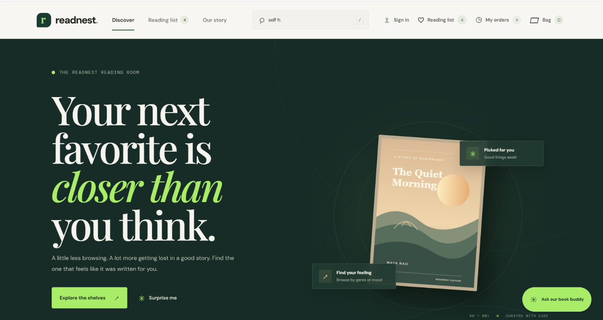

# AI Capstone Project — ReadNest Bookstore

ReadNest is a full-stack bookstore capstone project for discovering books and trying a complete demo shopping flow. The storefront is built with React and Vite; a Spring Boot API serves a seeded book catalog and demo order references.

## Storefront preview



## Features

- Browse and search a 100-book catalog, filter by category, and sort by title or price.
- See distinct book covers, publication dates, author profiles, previous works, and clearly labeled sample reviews.
- Save books to a reading list and add books to a persistent shopping bag.
- Use the book buddy for catalog-based recommendations by genre, mood, or budget. It is a local rule-based assistant, not an external AI service.
- Follow a responsive three-step checkout with delivery details, payment preference selection, and an order review.
- Choose demo payment preferences, including card networks, UPI apps, net banking, and cash on delivery.
- View browser-local order history and a simulated tracking timeline.
- Use the cached catalog if the backend is temporarily unavailable.

## Demo limitations

This project is a bookstore prototype. No payment provider is connected, no payment is collected, and no card, UPI, or bank credentials should be entered. Order tracking is simulated, and order history is stored in the current browser. Reviews and generated author profiles are sample demo content.

## Technology

| Area | Stack |
| --- | --- |
| Frontend | React 18, Vite, CSS |
| Backend | Java 21, Spring Boot 3, Spring Web |
| Data | Spring Data JPA, H2 |

## Run locally

Requirements: Java 21, Maven, and Node.js with npm.

1. Start the backend from the repository root:

   ```powershell
   cd backend
   mvn spring-boot:run
   ```

   The API starts at `http://localhost:8080`. The local H2 database is stored under `backend/data`.

2. In another terminal, start the frontend:

   ```powershell
   cd frontend
   npm install
   npm run dev
   ```

3. Open the URL printed by Vite, usually `http://localhost:5173`. Keep the backend running for live catalog and order API requests. Vite proxies `/api` calls to port `8080`.

Build the frontend for production:

```powershell
cd frontend
npm run build
```

## API

| Method | Endpoint | Description |
| --- | --- | --- |
| `GET` | `/api/books` | List the catalog |
| `GET` | `/api/books/{id}` | Get one book |
| `POST` | `/api/orders` | Create a demo order reference |

Example order request:

```json
{
  "customerName": "Rahul",
  "address": "Hyderabad",
  "paymentMethod": "UPI · Google Pay",
  "items": [
    {
      "bookId": 1,
      "quantity": 2
    }
  ]
}
```

## Project structure

```text
backend/   Spring Boot application, REST API, catalog seeder, and H2 configuration
frontend/  React storefront, checkout experience, styles, and bundled book covers
.bob/      Bob AI skills for the Spec Kit workflow
.github/   GitHub Copilot skills for the Spec Kit workflow
.specify/  Spec Kit configuration, integrations, scripts, templates, and constitution
```

## AI-assisted development

This repository includes Spec Kit configuration (version `1.2.5.dev0`) for a
specification-driven development workflow. The project is initialized with
GitHub Copilot as its default integration and also includes Bob integration
support. Their skills are provided in `.github/skills/` and `.bob/skills/`,
respectively.

The `.specify/` directory contains the integration manifests and settings,
PowerShell helper scripts, specification/plan/task templates, and the project
constitution in `.specify/memory/constitution.md`. A sample full-cycle workflow
is defined in `.specify/workflows/speckit/workflow.yml`: specify a feature,
review its specification, plan it, review the plan, generate tasks, and
implement them. Use the Spec Kit commands available in your chosen editor
integration; the installed Copilot and Bob skills provide guidance for the
individual workflow steps.

## Publishing to GitHub

The project can be pushed to GitHub.com and IBM's GitHub Enterprise as separate
remotes. Sign in to the appropriate account first, and do not put passwords or
access tokens in the remote URL or commit them to the repository.

For IBM GitHub, sign in through your organization's w3id/IBM Verify flow in the
browser, then authenticate Git Credential Manager with its browser flow:

```powershell
git credential-manager github login --url https://github.ibm.com --browser
```

Add the IBM repository as a remote (once) and push the current branch:

```powershell
git remote add ibm https://github.ibm.com/amulyavemulapally101/ai-capstone.git
git push -u ibm main
```

For another repository, replace the remote URL with its HTTPS clone URL. If a
remote already exists, update it with `git remote set-url <remote> <url>` rather
than adding it again. Git Credential Manager may reuse a saved sign-in; otherwise
complete the browser authentication prompt.
